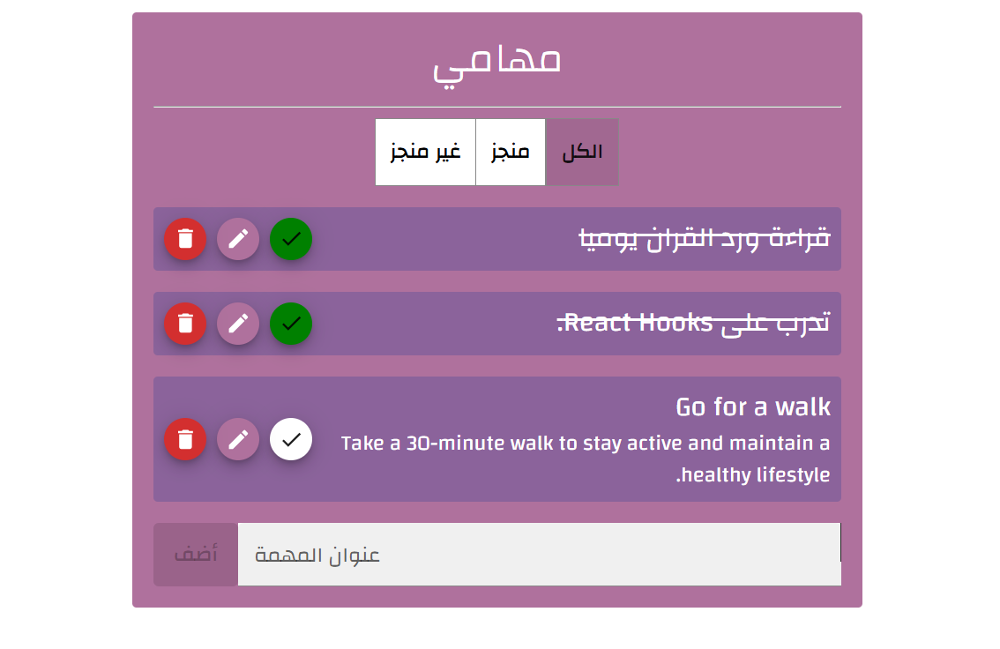

# To-Do List App

A simple and responsive To-Do List application built with React and Material UI to help users manage their daily tasks.

## Live Demo

[View the To-Do List App](https://react-to-do-list09.netlify.app/)

## Preview



## Features

- Add new tasks.
- Edit task titles and descriptions.
- Delete tasks with a confirmation dialog.
- Mark tasks as completed or incomplete.
- Filter tasks by status: All, Completed, and Not Completed.
- Save tasks in Local Storage so they remain after refreshing the page.
- Display toast notifications when performing actions.

## Technologies Used

- React
- JavaScript
- Material UI (MUI)
- React Context API
- useReducer
- useState and useEffect
- Local Storage
- CSS

## Getting Started

### Prerequisites

Make sure you have Node.js and npm installed.

### Installation

1. Clone the repository:

   ```bash
   git clone https://github.com/hajarhr55/react-to-do-list
   ```

2. Navigate to the project directory:

   ```bash
   cd to-do-list
   ```

3. Install the dependencies:

   ```bash
   npm install
   ```

4. Start the development server:

   ```bash
   npm start
   ```

The application will open in your browser, usually at `http://localhost:3000`.

## What I Learned

- Managing shared state using React Context.
- Handling state updates with `useReducer`.
- Using React hooks to manage component state and side effects.
- Saving and retrieving data using Local Storage.
- Building reusable components and dialogs with Material UI.

## Author

Hajar Al-Anazi

---

# تطبيق قائمة المهام

تطبيق بسيط ومتجاوب لإدارة المهام اليومية، تم تطويره باستخدام React وMaterial UI لمساعدة المستخدمين على تنظيم مهامهم ومتابعة إنجازها.

## تجربة التطبيق

[اضغط هنا لفتح تطبيق قائمة المهام](https://react-to-do-list09.netlify.app/)

## معاينة التطبيق


## المميزات

- إضافة مهام جديدة.
- تعديل عناوين المهام وأوصافها.
- حذف المهام مع نافذة تأكيد.
- تحديد المهام كمكتملة أو غير مكتملة.
- تصفية المهام حسب الحالة: الكل، مكتملة، وغير مكتملة.
- حفظ المهام في Local Storage لتبقى بعد تحديث الصفحة.
- عرض إشعارات عند تنفيذ العمليات.

## التقنيات المستخدمة

- React
- JavaScript
- Material UI (MUI)
- React Context API
- useReducer
- useState وuseEffect
- Local Storage
- CSS

## طريقة التشغيل

### المتطلبات

تأكد من تثبيت Node.js وnpm على جهازك.

### التثبيت والتشغيل

1. استنسخ المستودع:

   ```bash
   git clone https://github.com/hajarhr55/react-to-do-list
   ```

2. انتقل إلى مجلد المشروع:

   ```bash
   cd to-do-list
   ```

3. ثبّت الحزم المطلوبة:

   ```bash
   npm install
   ```

4. شغّل التطبيق:

   ```bash
   npm start
   ```

سيفتح التطبيق في المتصفح، عادةً على العنوان `http://localhost:3000`.

## ما تعلمته من المشروع

- إدارة الحالة المشتركة باستخدام React Context.
- تحديث الحالة باستخدام `useReducer`.
- استخدام React Hooks لإدارة حالة المكونات والتأثيرات الجانبية.
- حفظ البيانات واسترجاعها باستخدام Local Storage.
- بناء مكونات قابلة لإعادة الاستخدام ونوافذ حوار باستخدام Material UI.

## المطورة

هاجر العنزي
